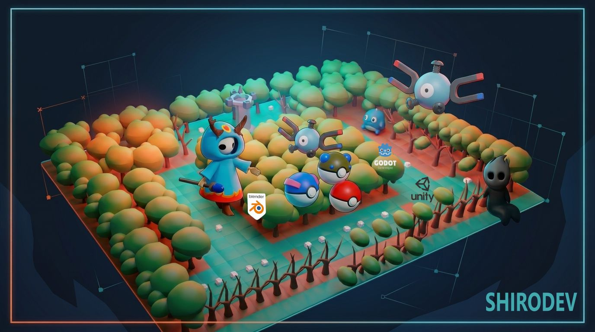

  

<h1 align="center">¡Hola, soy David Beltrán (Shiro)! 👋 🎮💻</h1>

  <b>Ingeniero en Informática &bull; Desarrollador Full Stack &bull; Game Creator &bull; 2D/3D Technical Artist</b>

  
  
  

---

### 🚀 Sobre mí

Me apasiona construir **mecánicas y sistemas de videojuegos**, **herramientas de optimización y add-ons para artistas 3D** en Blender, y **aplicaciones móviles y soluciones web escalables**.

- 🎯 **Enfoque principal:** Integración de arte y programación (Technical Art, Shaders, Pipelines 3D/2D).
- 🕹️ **Game Development:** Desarrollo con Godot Engine y Unity, prototipado de mecánicas y game feel.
- 💡 **Open Source & Herramientas:** Creando add-ons para agilizar el flujo de trabajo de creativos digitales.

---

### 🛠️ Stack Tecnológico y Herramientas

  

<b>📂 Categorías y Tecnologías</b>

 

| Categoría | Tecnologías y Herramientas |
| :--- | :--- |
| **🎮 Game Dev & 3D Art** | Godot Engine, Unity, Blender *(Modelado, Rigging, Shaders, Add-ons en Python)* |
| **📱 Mobile & Plugins** | Flutter, Dart, Native Android Plugins *(Java/Kotlin)* para Godot |
| **🌐 Backend & Web** | Laravel, Express.js, Node.js, PHP, JavaScript, TypeScript, REST APIs |
| **💻 Lenguajes de Programación** | Python, C++, C#, GDScript, Dart, PHP, JavaScript, TypeScript |
| **⚙️ Entornos y Control de Versiones** | Git, GitHub, Android Studio, VS Code |

---

### 🔭 Proyectos Destacados & Publicaciones

| Proyecto | Categoría | Descripción | Enlaces |
| :--- | :--- | :--- | :--- |
| 🎨 **Krita Live Texturing for Blender** | Blender Add-on (Python) | Add-on para Blender que automatiza la exportación de UVs, apertura de canvas y sincronización de texturas en tiempo real con Krita. | [🌐 Marketplace](https://teamapricot.com/marketplace/krita-live-texturing-for-blender) |
| 📱 **Voxel Pixel Animations** | Google Play Store | Creador de apps, animaciones voxel/pixel y utilidades interactivas desarrolladas en Flutter y Godot. | [📲 Google Play](https://play.google.com/store/apps/dev?id=6083272565864352853) |
| 🎮 **Elevator** | Videojuego Indie | Juego de terror psicológico en primera persona basado en observación de anomalías y atmósfera inmersiva. | *🎮 En desarrollo* |
| 🌐 **Team Apricot Marketplace** | Herramientas & Recursos 3D | Desarrollo y publicación de add-ons, herramientas y assets para creadores y desarrolladores. | [🛒 Ver tienda](https://teamapricot.com/) |

---

### 📊 Estadísticas de GitHub

  
  

---

### 📫 Conéctate conmigo

  
  
  
  

